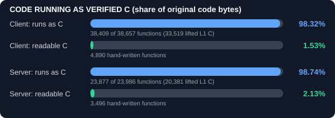

# Battlefield Vietnam Reconstruction

Battlefield Vietnam (2004), client and dedicated server, rebuilt as C so the game
logic can be read, modded and recompiled.

You need your own copy of the game. This repo has **no game assets or original EXEs**.

## Progress

| Stage | What it means | Client | Server |
| --- | --- | ---: | ---: |
| **L1: lifted C** | Every function translated to C mechanically and checked against the original. Works, but looks like assembly. | **98.3%** | **98.7%** |
| **L2: structured C** | Real variables, `if`/`while`, no CPU registers | not started | not started |
| **L3: readable C/C++** | Named classes, fields and functions | 8,121 functions | (shared count) |

- The game boots and runs with the lifted C in place: the server ran 180 s and the client 90 s with no faults.
- Whole-game goal (fully readable source with no original code): **0 of 7 milestones**. See [PROGRESS](docs/PROGRESS.md).



## How it works

1. `lift_c.py` translates each function of the EXE into C.
2. `verify_lifted.py` runs the original and the C side by side in an emulator and compares every memory access and call.
3. `build.py` compiles the verified C and patches it into a copy of the EXE. The original files are never touched.

## Quick start

Requirements: Windows, [uv](https://docs.astral.sh/uv/), 32-bit MinGW (`C:\msys64\mingw32\bin`), and the game version listed in [SETUP](docs/SETUP.md).

```powershell
$env:BFV_GAME_DIR = 'C:\path\to\Battlefield Vietnam'
.\bfv-native-code\build.ps1     # build the editable EXEs
.\bfv-native-code\run.ps1       # play (run-server.ps1 for the server)
```

To mod, find the code in `bfv-native-code/lifted/<target>/` (sorted into the game's own folders, e.g. `bf/ai/`, `ref2/world/BFSoldier.c`), edit it and rebuild. `tools/find.py` searches it by string, class or address, and `CONSOLE.tsv` maps all ~2,250 console/script commands (like `ObjectTemplate.repairFactor`) to their code. See **[MODDING.md](docs/MODDING.md)**.

## Folders

| Path | Contents |
| --- | --- |
| `bfv-native-code/lifted` | Lifted C (L1), in the game's original folder/file names |
| `bfv-native-code/src` | Readable C (L3) |
| `bfv-native-code/tools` | Lifter, verifier, build and recompiler |
| `docs` | [Lifted C](docs/LIFTED-C.md), [Static recomp](docs/STATIC-RECOMP.md), [Handoff](docs/HANDOFF.md) |

See [NOTICE.md](NOTICE.md) for legal details.
